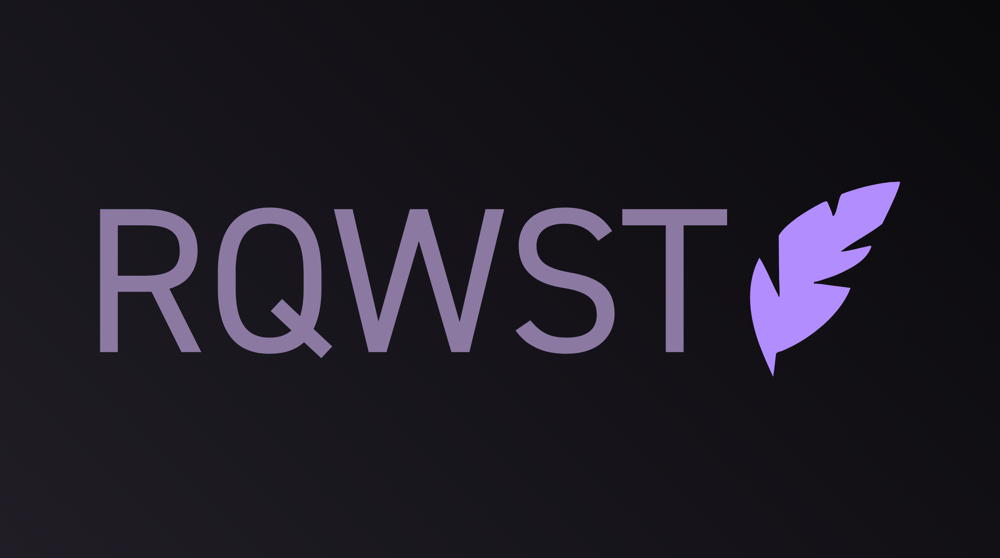

# RQWST // design demo



**Live demo:** [rqwst.a-s-k.studio](https://rqwst.a-s-k.studio/)

This repository applies [design-system-ASK](https://github.com/apexSolarKiss/design-system-ASK) to RQWST's identity. The page opens with RQWST's public landing page, set in the design system's roles, and continues into a content-reduced concept example: a short concept statement, then a sample request, a sequence, a status panel and a table of sample requests, written for this public demo.

It is not an official RQWST publication, a product specification or an endorsement. The landing section's copy, apart from the label above its headline, is RQWST's own, as [rqwst.com](https://rqwst.com/) showed it on 14 November 2026, and its sign-in, application, terms and contact links lead there. Every name, outlet, date and count in the concept samples is invented. The page collects nothing: it has no forms, accounts, cookies or analytics.

The design system supplies the interface, unchanged: type, color, the page shell and its navigation, the compact actions, the panel material and the document register with its tables, in light and dark. This repository supplies RQWST's identity and the page: the wordmark and the plume, the presentation assignment that gives the light theme RQWST's lavender field, the page's composition of the landing copy, its own words and samples, and its layout and print rules.

## The page

`index.html` is the published page, sealed into one self-contained file: every stylesheet, script, font and image it uses is inlined, so it loads nothing from anywhere else. Its authoring source is `source/pages/public-demo.html`, and its artifact id is `rqwst-public-demo`. `PROVENANCE.md` records each release.

## Run it

The site has no build step and no dependencies to install.

- **Open it:** open `index.html` in a browser.
- **Or serve it:** from this folder, run `python3 -m http.server 8000` and visit `http://localhost:8000/`.

To work on the page, open or serve `source/pages/public-demo.html` instead: it loads the design system's files and the page's own stylesheets and assets as separate files. When it is ready, seal it and check the result:

```text
python3 tools/seal.py
python3 tools/check.py --donor <a design-system-ASK clone>
```

## What to edit

| Yours to edit | What it is |
|---|---|
| `source/pages/public-demo.html` | the page: the landing section, the concept example's words and samples, its sections and navigation entries |
| `source/styles/rqwst.css` | the page's own layout and print rules: the lockup's proportions, the landing section's top bar and stacking, the steps list's lead in its section, the panel planes and their labeled pairs, the table's short columns and the provenance footer on a narrow column. No color, font or type size of its own |
| `source/styles/rqwst-assignment.css` | the RQWST presentation assignment: the light field's two stops, bound on the design system's own field mechanism. Every other color role is the design system's |
| `source/assets/rqwst-assignment.json` | the assignment's declaration, which the design system's role-conformance check reads |
| `source/assets/rqwst-wordmark.svg` // `rqwst-plume.svg` | RQWST's identity: the wordmark and the plume, each bounded to its own painted edges |
| `source/assets/rqwst-lockup.svg` // `identity-extraction.json` | the two parts composed as RQWST's lockup, and where each part sits in it. The page composes the lockup from its parts with these numbers; the lockup file itself is a reference, drawn by the repository artwork and not by the page |
| `source/styles/output-artifact.template.css` | the design system's `output-artifact` template overlay, kept as the page's own copy. Change it only to follow the template |
| `favicon.svg` | the browser icon: the plume, in its own color, on a square canvas. The page embeds it |
| `rqwst-ds-demo-banner.svg` | the repository artwork: the lockup on the dark field the page shows in dark mode, the design system's own. `rqwst-ds-demo-banner.png`, this README's banner, is its 2752 × 1536 export, and `og-image.png`, the page's link preview, is its full-width centered crop at 1200 × 630. Each PNG records the banner's SHA-256, so `tools/check.py` can tell when an export is stale |

| Not to edit | Why |
|---|---|
| `index.html` | the sealed page. `tools/seal.py` writes it from the source; edit the source and seal again |
| `source/_dsa-tokens/` // `source/_dsa-surface/` | design-system-ASK's files, copied unmodified. `VENDOR.md` lists each with its git blob and SHA-256, gives the load order and says how to re-sync them. A local difference goes in `source/styles/rqwst.css` instead |
| `licenses/design-system-ASK/` | design-system-ASK's own license and notice, which travel with its files |

**Identity.** The page opens on RQWST's lockup, the wordmark beside the plume, across the column, with the shell's `/// DESIGN DEMO` note beneath it. As the page scrolls, the wordmark leaves with it, and the plume alone stays as the navigation control: top left on a desktop and bottom right on a phone. This is the design system shell's expanded identity; `source/styles/rqwst.css` declares the lockup's proportions and where each part sits in it, from `identity-extraction.json`. The page's title, RQWST, stays the document's heading and names the page in the navigation, but is not shown, because the wordmark already shows it.

**Light and dark.** The page follows the reader's system setting. In the light theme the field is RQWST's lavender, `#D4C6E1` to `#EBDEE8`, bound by the presentation assignment, and the text keeps the design system's light foreground. In the dark theme every role is the design system's. The wordmark and the plume keep their own colors in both.

**Navigation.** The navigation panel is built by `source/_dsa-surface/surface-shell.js` from the `<template class="surface-nav-source">` at the foot of the page. Its entries are the page's sections: choosing one closes the panel and moves to that section. Below them, the template's `surface-nav-utilities` row carries three routes off the page, rqwst.com, the repository and design-system-ASK, which open in a new tab. To add a section, give its heading an `id` and add a row for it to the template.

**Print.** The page prints in its screen roles and composition, through the browser's own margins and page breaks. The shell keeps its navigation off paper and prints the lockup where it rests, whether the panel is open or closed. The page's own print rules print the field's edge color, flat, to the paper's edge in either theme, leave the footer's controls on screen, and keep a heading with what follows it, and a group, plane or table, or the landing section's top bar or headline, on one page.

## Releases

Each release is tagged `public-demo-v<N>` at the commit that lands it on `main`, and recorded in `PROVENANCE.md`. This repository's history starts with release 1.

## Deploy it

`vercel.json` serves the folder as it is, with no install or build step, and sets the same security headers as the design system's own site. `main` is production. The deployment serves the sealed release: `.vercelignore` leaves out `source/` and `tools/`, which are for reproducing it in the repository. Another static host needs its own exclusion of `source/` and `tools/`; serving the repository root without one also serves the unsealed source as a second copy of the page.

## Licenses

The code and reusable interface implementation in this repository are licensed under the Apache License 2.0 (`LICENSE`). `NOTICE` lists what else is included and under what terms. The design-system files are Apache-2.0, and the typefaces are under the SIL Open Font License 1.1.

RQWST identity artwork created by Andrew S Klug // ASK, the wordmark and the plume, is excluded from the Apache License 2.0. All rights reserved. Here that is the three identity drawings in `source/assets/` (`rqwst-wordmark.svg`, `rqwst-plume.svg` and `rqwst-lockup.svg`), the same drawings embedded in `index.html`, `favicon.svg` and the repository artwork that shows them: `rqwst-ds-demo-banner.svg`, `rqwst-ds-demo-banner.png` and `og-image.png`.

The page's copy and its sample content are excluded from the Apache License 2.0, and no license is granted for them. The landing section's copy, apart from its label, is RQWST's own, from rqwst.com. The concept samples are illustrative and fictional.
